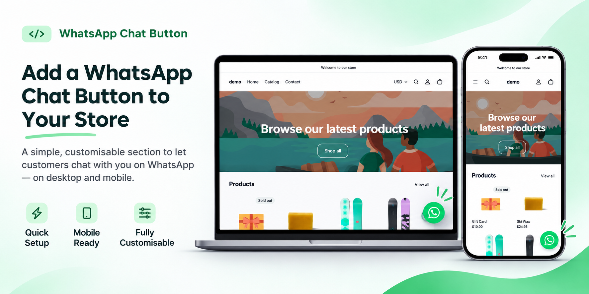
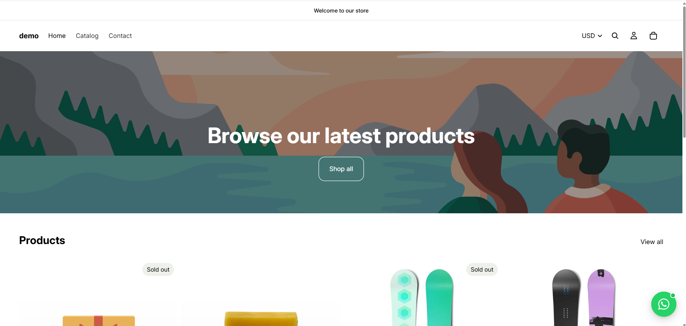
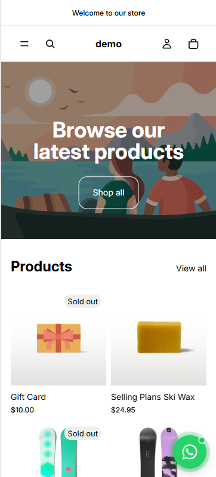
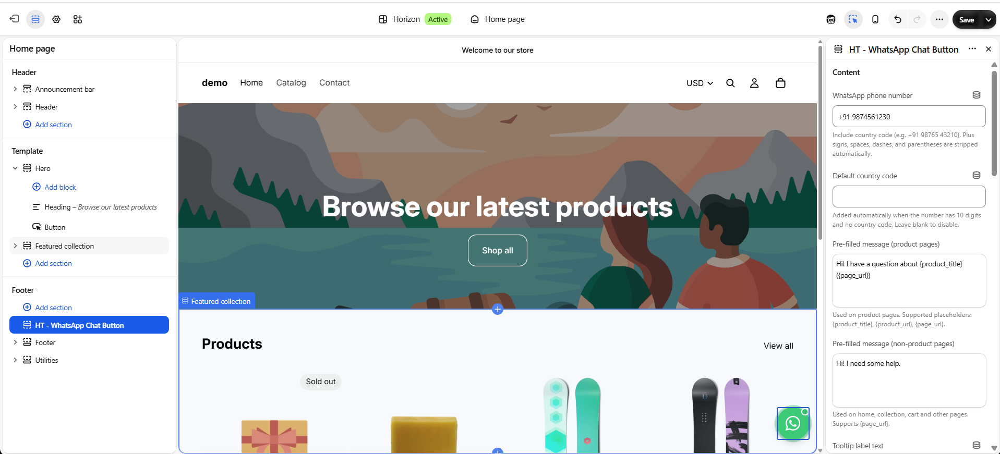

<div align="center">

# 💬 WhatsApp Chat Button for Shopify

**A free, customizable floating WhatsApp button section for Shopify Online Store 2.0 themes.**
No app. No jQuery. No monthly fees.




</div>

---

## ✨ Features

- 💬 **Pre-filled messages** with dynamic placeholders (product name, product URL, page URL)
- 🛍️ **Separate messages** for product pages and all other pages
- 🇮🇳 **Smart phone formatting**: strips `+`, spaces, dashes and brackets, and auto-adds a default country code (e.g. `91`) to 10-digit numbers
- 📍 **Position control**: left or right, with separate desktop and mobile offsets
- 🎨 **Style options**: size (44-80px), circle or rounded square, custom colors, drop shadow, green "online" dot
- 🏷️ **Tooltip label**: show always, on hover, or auto-show once then hide
- 🎬 **Animations**: pulse ring, slide/fade entrance, appear delay (all optional)
- 👁️ **Visibility rules**: show or hide on desktop and mobile, and hide on home, product, collection, cart, blog and standard pages
- 📊 **Analytics-ready**: fires a `ht:whatsapp-click` event and pushes `whatsapp_click` to `dataLayer` if it exists
- ♿ **Accessible**: `aria-label`, keyboard focus outline, 44px minimum touch target, `prefers-reduced-motion` support
- 🌍 **RTL friendly** using CSS logical properties
- 📱 **iPhone safe-area** support so it never hides behind the home bar
- 🔒 **Scoped CSS and JS**: multiple instances will not clash with your theme

---

## 📸 Preview

### Desktop



### Mobile



### Theme Editor Settings

Everything is configurable from the Shopify theme editor. No code needed for day-to-day changes.



---

## 🚀 Installation

### Step 1: Add the section file

1. Go to **Shopify Admin → Online Store → Themes**.
2. Click **⋯ → Edit code** on your theme.
3. Under **Sections**, click **Add a new section**.
4. Name it `ht-whatsapp-chat-button` and click **Done**.
5. Delete the default code, paste the full contents of [`ht-whatsapp-chat-button.liquid`](./ht-whatsapp-chat-button.liquid), and click **Save**.

### Step 2: Add it to your store (on every page)

A floating button should appear on all pages, so add it to a **section group** (such as the footer):

1. Go to **Online Store → Themes → Customize**.
2. Scroll down to the **Footer** area.
3. Click **Add section** and choose **HT - WhatsApp Chat Button**.
4. Enter your WhatsApp number and adjust the settings.
5. Click **Save**.

> 💡 If you add it directly to a single template (for example the home page), it will only appear on that page.

---

## ⚙️ Settings

| Group | Setting | Description |
|---|---|---|
| **Content** | WhatsApp phone number | Your number. Symbols and spaces are stripped automatically. |
| | Default country code | Added when the number has 10 digits and no country code (default `91`). Leave blank to disable. |
| | Pre-filled message (product pages) | Supports `{product_title}`, `{product_url}`, `{page_url}`. |
| | Pre-filled message (non-product pages) | Used on home, collection, cart and other pages. Supports `{page_url}`. |
| | Tooltip label text | Text in the bubble next to the button. Leave blank to hide it. |
| | Tooltip display behavior | Show always, on hover/focus, auto-show once, or hidden. |
| | Tooltip auto-hide after | 2-15 seconds (for the "auto-show once" mode). |
| | Accessibility label | Read aloud by screen readers. |
| **Position** | Horizontal alignment | Left or right. |
| | Bottom / side offset (desktop) | 8-120px. |
| | Bottom / side offset (mobile) | 8-120px. |
| | Z-index | Stacking order above other floating elements. |
| **Style** | Button size | 44-80px. |
| | Button shape | Circle or rounded square. |
| | Background / icon color | Defaults to WhatsApp green and white. |
| | Drop shadow | On or off. |
| | Online dot | Show or hide the green status dot. |
| **Animation** | Pulse ring | On or off. |
| | Entrance animation | Slide/fade in. |
| | Delay before button appears | 0-10 seconds. |
| **Visibility** | Show on desktop / mobile | Breakpoint is 750px. |
| | Hide on home / product / collection / cart / blog / pages | Hide the button on selected page types. |

---

## 🔤 Message Placeholders

| Placeholder | Replaced with |
|---|---|
| `{product_title}` | Current product name (falls back to the page title on other pages) |
| `{product_url}` | Full product URL |
| `{page_url}` | Full URL of the current page |

**Example**

```
Hi! I have a question about {product_title} ({page_url})
```

---

## 📊 Tracking Clicks (optional)

Every click fires a browser event you can listen to:

```js
document.addEventListener('ht:whatsapp-click', function (e) {
  console.log(e.detail); // { sectionId, href, pageUrl }
});
```

If `window.dataLayer` exists (Google Tag Manager), `{ event: 'whatsapp_click' }` is pushed automatically. Nothing breaks if analytics scripts are missing.

---

## ✅ Quick Test Checklist

- [ ] Enter a number like `9876543210` and confirm the link opens `wa.me/919876543210`
- [ ] Open a product page and confirm the message includes the product name
- [ ] Open the home page and confirm the general message is used
- [ ] Hover over the area next to the button (tooltip hidden) and confirm it is not clickable
- [ ] Switch left/right and check desktop and mobile offsets
- [ ] Turn on "Reduce motion" in your OS and confirm the pulse stops

---

## 🌐 Compatibility

- Works with **Online Store 2.0** themes (built and tested on **Dawn**)
- Pure Liquid, CSS and vanilla JavaScript
- Works in all modern browsers (Chrome, Safari, Firefox, Edge)

---

## 📁 Repository Structure

```
shopify-sections-whatsapp-chat-button-/
├── ht-whatsapp-chat-button.liquid
├── README.md
├── hero-image.png
├── pc-preview.png
├── mobile.png
└── edit-view.png
```

---

## 🤝 Contributing

Found a bug or have an idea? Open an [issue](../../issues) or submit a pull request.

---

## 👨‍💻 Author

**Harish Thangam**: Webflow, Shopify and WordPress developer

- GitHub: [@harishthangam2003-max](https://github.com/harishthangam2003-max)
- LinkedIn: [Harish Thangam](https://www.linkedin.com/in/harishthangam/)

⭐ If this saved you time, please star the repo. It helps other store owners find it.
